# ClaimPilot

**An agentic co-pilot that adjudicates auto insurance claims in seconds: policy checks, cited coverage reasoning, fraud scoring and settlement, with a human in the loop where it matters.**

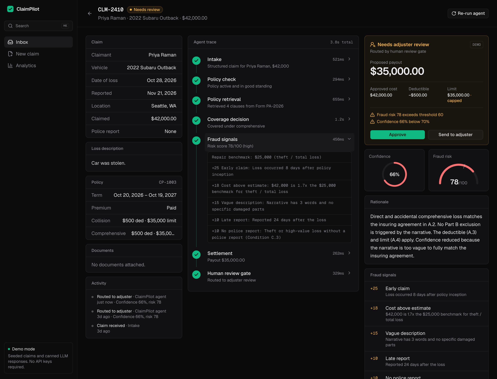

<sub>Claim detail for CLM-2410. The agent covered the theft under comprehensive, capped the payout at the $35,000 limit, and routed it to an adjuster because five fraud signals pushed the risk score to 78.</sub>

---

## Contents

- [The problem](#the-problem)
- [What ClaimPilot does](#what-claimpilot-does)
- [How it works](#how-it-works)
- [Screenshots](#screenshots)
- [Demo walkthrough](#demo-walkthrough)
- [Quick start](#quick-start-demo-mode-no-keys)
- [Deploy for free](#deploy-for-free)
- [API](#api)
- [Project structure](#project-structure)
- [Design decisions](#design-decisions)
- [Acknowledgements](#acknowledgements)

## The problem

First notice of loss is still mostly manual. An adjuster:

1. reads a narrative from an email or a call,
2. looks up the policy and confirms the premium is paid and the loss date is covered,
3. hunts through the policy wording for the insuring agreement and any exclusion that applies,
4. sanity-checks the repair estimate against what that damage usually costs,
5. does the deductible and limit math, and
6. decides whether the claim looks suspicious enough to investigate.

That is slow, inconsistent between adjusters, and the reasoning is rarely written down. Most claims are routine, yet they all wait in the same queue as the ones that need real judgment.

## What ClaimPilot does

ClaimPilot automates the routine path end to end and makes every step auditable:

- **Clean claims** are approved in about four seconds, with the payout computed and the governing clauses cited.
- **Claims that fail policy terms** (lapsed premium, loss outside the coverage period, an exclusion such as racing or rideshare use) are denied, citing the exact clause.
- **Risky or ambiguous claims** are routed to an adjuster with the evidence already assembled: every fraud signal with its weight, the retrieved clauses, the proposed payout and the agent's confidence.

Each decision returns:

| Field | Example |
| --- | --- |
| Decision | `Approve`, `Deny` or `Review` |
| Payout | `$3,780.00` (approved cost $4,280 less $500 deductible) |
| Confidence | `91%` |
| Cited clauses | `A.1 Insuring Agreement — Collision`, `A.3 Deductible`, `A.4 Limit of Liability` |
| Fraud flags | `+25 Early claim: loss occurred 8 days after policy inception` |
| Trace | Every step with its status, duration, summary and detailed reasoning |

## How it works

A [LangGraph](https://langchain-ai.github.io/langgraph/) state machine runs seven nodes. Each node emits a `step_start` and a `step_end` event, which the API streams to the browser over Server-Sent Events. The reasoning trace fills in live while the agent works.

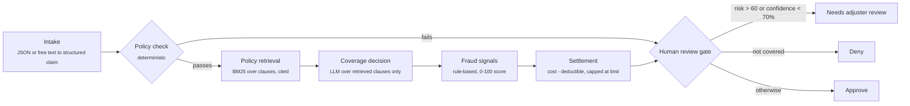

### The seven steps

**1. Intake.** Accepts structured JSON or a free-text narrative such as an email or a call transcript. It extracts the policy number, claimant, dates, amount, vehicle and whether a police report exists. Missing details are filled from the policy record, for example the vehicle on the declarations page. In live mode Claude does the extraction; demo mode uses a rule-based extractor.

**2. Policy check (no LLM).** Three hard rules: the policy exists, the premium is paid, and the date of loss falls inside the coverage period, boundaries inclusive. If any rule fails, the graph skips straight to the review gate and the claim is denied with the reason.

**3. Policy retrieval.** The policy wording (`backend/app/data/policy_document.md`, Form PA-2026) is chunked into clauses such as `A.2 Insuring Agreement — Comprehensive` and `B.3 Exclusion — Commercial Use, Rideshare and Delivery`. Retrieval runs two BM25 queries:
- a **coverage query**: the narrative plus coverage terms, which finds the insuring agreement, deductible and limit clauses;
- an **exclusion probe**: the narrative alone, searched over Part B only, so an exclusion like "delivering a DoorDash order" is never missed.

Each clause comes back with a normalised relevance score, so citations stay exact and traceable.

**4. Coverage decision.** The LLM receives the claim, the declarations and **only the retrieved clauses**, and must cite clause ids. Exclusions override insuring agreements. In demo mode a canned reasoner applies the same rules over the same retrieved clauses, so results are deterministic. Confidence drops when the narrative is vague or the governing clause was not retrieved.

**5. Fraud signals (no LLM).** Weighted rules produce a 0 to 100 score, and every point is explained:

| Signal | Weight | Trigger |
| --- | --- | --- |
| Early claim | +25 / +12 | Loss within 30 / 60 days of policy inception |
| Cost far above estimate | +30 / +18 | Claimed amount ≥ 2.0x / 1.5x the repair benchmark for that damage type |
| Repeat claims | +20 / +8 | 2+ / 1 prior claims on the policy in the last 12 months |
| Vague description | +15 | Fewer than 12 words or no specific damaged parts |
| Late report | +10 | Reported more than 14 days after the loss |
| No police report | +10 | Theft, or a loss above $10,000, without a police report (Condition C.3) |

**6. Settlement (no LLM).** `payout = min(max(approved cost − deductible, 0), limit)`, using the deductible and limit for the coverage that applies (collision or comprehensive). Capped payouts are flagged.

**7. Human review gate.** The claim goes to an adjuster if the risk score is above 60 or confidence is below 70%. Otherwise it is auto-approved, or auto-denied if it is not covered.

## Screenshots

### Claims inbox
Status pills, a risk bar per claim, search, and filters with live counts.

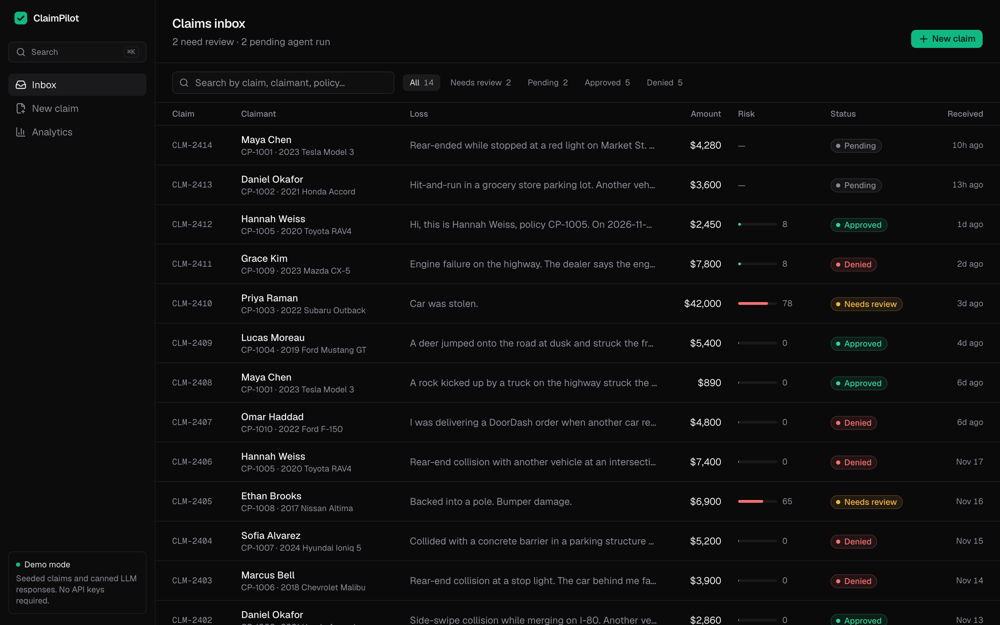

### Live agent run
Open a pending claim and the agent runs immediately. Each step shows a spinner, then a check and its duration; the decision panel waits for the review gate.

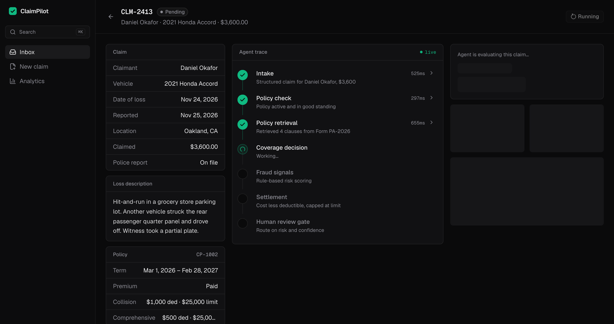

### Auto-approved claim
A hit-and-run with a police report and a fair estimate, auto-approved. The coverage step is expanded to show the agent's reasoning and citations.

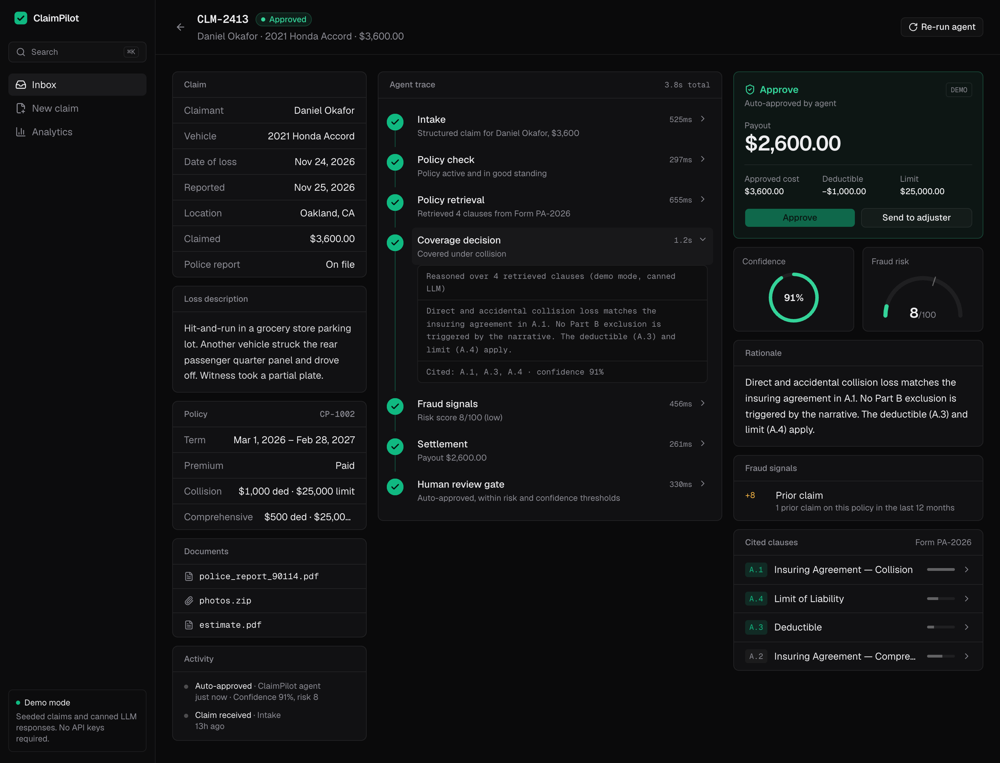

### Denied on an exclusion
The insured was making a DoorDash delivery. Retrieval surfaced exclusion B.3, the coverage step cited it, and the clause text is expanded on the right.

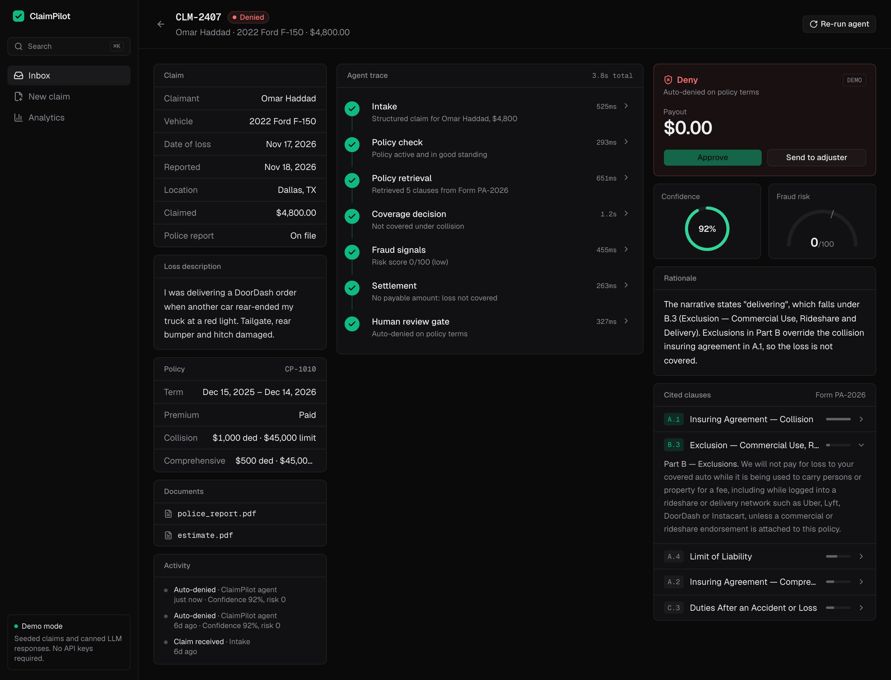

### New claim
A structured form or free-text intake, with three one-click samples: clean approve, deny for exclusion, and fraud flagged. Samples also deep-link: `/claims/new?sample=fraud`.

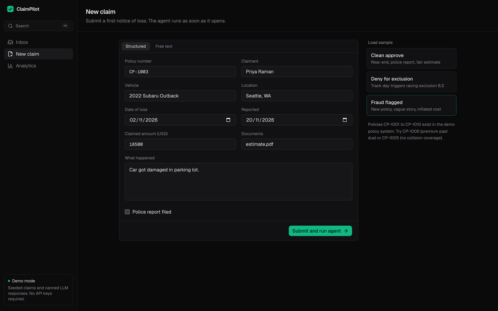

### Cmd+K search
Jump to any claim by ID, claimant, policy or vehicle from anywhere in the app.

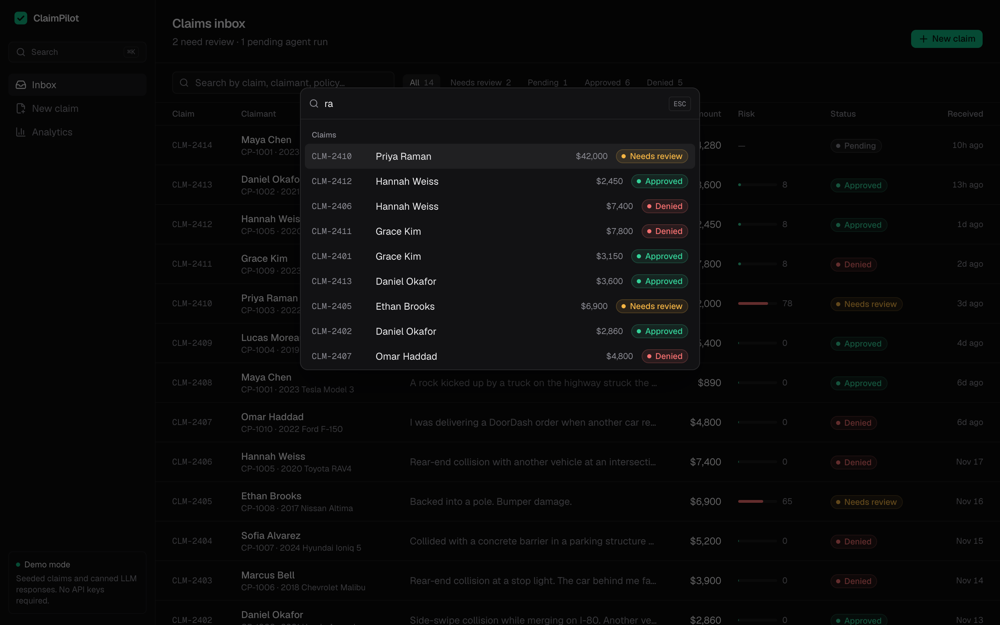

### Analytics
Straight-through rate, approved payouts, average fraud risk, decisions by day and the most frequent fraud signals.

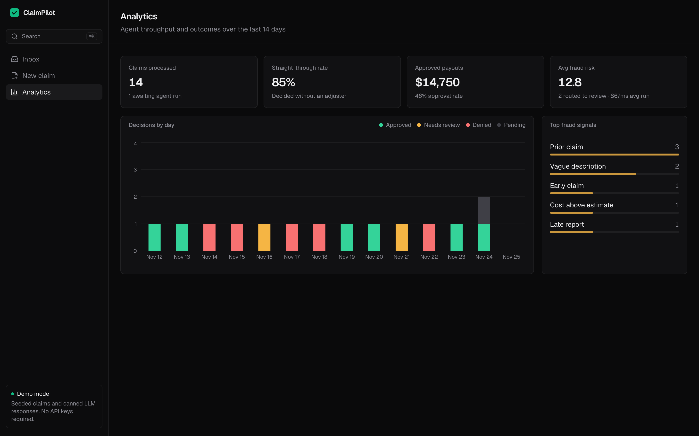

### Mobile
Fully responsive: the timeline and decision card stack on small screens.

<p>
  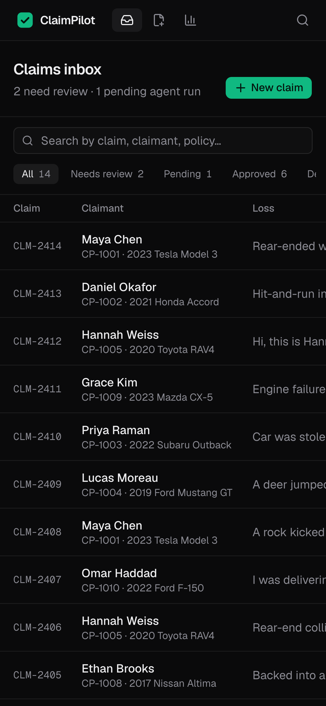
  &nbsp;&nbsp;
  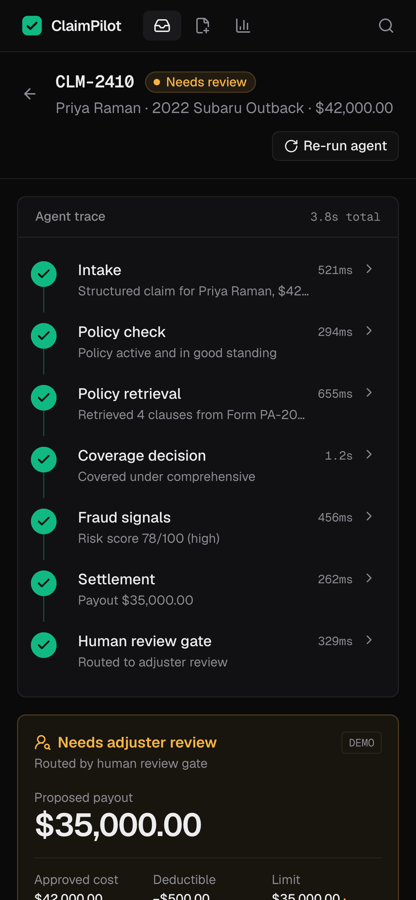
</p>

## Demo walkthrough

A five-minute tour once both servers are running:

1. **Inbox.** 14 seeded claims cover every outcome. Two are **Pending**.
2. **Watch it think.** Open `CLM-2414` (Maya Chen, rear-ended at a red light). The agent runs live, auto-approves, and pays $3,780 ($4,280 less the $500 collision deductible).
3. **Expand a step.** Click **Coverage decision** in the trace to read the reasoning, or **Fraud signals** to see each rule that fired.
4. **The hard cases.**
   - `CLM-2410`: a stolen-car claim filed 8 days after the policy started, 3 words long, no police report. Risk 78, routed to review.
   - `CLM-2407`: denied under the delivery exclusion B.3.
   - `CLM-2403`: denied because the premium is past due.
   - `CLM-2406`: denied because the policy carries no collision coverage.
5. **Human in the loop.** On a review claim, click **Approve** or **Send to adjuster**. The action is recorded in the activity log.
6. **Submit your own.** Go to **New claim**, choose a sample (or switch to **Free text** and click **Insert example narrative**), then **Submit and run agent**.
7. **Search.** Press `Cmd+K` and type a name.
8. **Analytics.** Totals update with every claim you run.

## Tech stack

| Layer | Tools |
| --- | --- |
| Agent | LangGraph (`StateGraph`, conditional edges, custom stream events) |
| Backend | Python 3.11+, FastAPI, Pydantic v2, SSE streaming, uv |
| LLM (live mode) | Anthropic Python SDK with structured outputs (`messages.parse`), `claude-opus-5-5` by default |
| Retrieval | BM25 written from scratch over clause-level chunks, no external services |
| Frontend | Next.js 16 (App Router), React 19, TypeScript, Tailwind CSS v4, shadcn/ui |
| UI details | Motion (Framer Motion) transitions under 200ms, Recharts, cmdk, Geist and Geist Mono, tabular figures for money |
| Tests | pytest: policy check, fraud scoring, settlement math, API streaming |

## Quick start (demo mode, no keys)

Prerequisites: [uv](https://docs.astral.sh/uv/), and Node 20+ with pnpm.

**1. API on port 8000**

```bash
cd backend
uv sync
uv run uvicorn app.main:app --port 8000
```

**2. Web app on port 3000** (in a second terminal)

```bash
cd frontend
pnpm install
pnpm dev
```

Then open http://localhost:3000.

**Run the tests**

```bash
cd backend && uv run pytest
```

Demo mode is the default. It uses seeded claims and canned LLM responses, so everything works offline. The claim store is in memory: restarting the API resets the demo data.

### Live mode (optional)

Copy `backend/.env.example` to `backend/.env`, set `DEMO_MODE=false` and add `ANTHROPIC_API_KEY`. Free-text intake and the coverage decision will then call Claude with structured outputs. If a call fails, the node falls back to the deterministic reasoner and records that in the trace. `.env` is gitignored.

| Variable | Default | Purpose |
| --- | --- | --- |
| `DEMO_MODE` | `true` | Canned LLM responses, no network |
| `DEMO_STEP_DELAY_MS` | `650` | Per-step pacing while streaming in demo mode, so the timeline is watchable |
| `ANTHROPIC_API_KEY` | — | Required for live mode |
| `CLAIMPILOT_MODEL` | `claude-opus-5-5` | Model for live mode |
| `CORS_ORIGINS` | `http://localhost:3000` | Comma-separated list of allowed web origins |
| `CORS_ORIGIN_REGEX` | any `localhost` port | Extra allowed origins as a regex, e.g. `https://.*\.vercel\.app` |
| `NEXT_PUBLIC_API_URL` | `http://localhost:8000` | API base URL for the frontend (read at build time) |

## Deploy for free

The API runs on **Render** and the web app on **Vercel**. Both have free plans and deploy from this GitHub repo, with no credit card.

**1. API on Render**

1. Sign in at [render.com](https://render.com) with GitHub.
2. Choose **New**, then **Blueprint**, and select this repository. Render reads [`render.yaml`](render.yaml) and creates `claimpilot-api` on the free plan, in demo mode, with CORS open to `*.vercel.app`.
3. Click **Apply** and wait for the deploy to finish (about 2 to 3 minutes).
4. Copy the service URL, e.g. `https://claimpilot-api.onrender.com`, and check that `/health` returns `{"status":"ok"}`.

**2. Web app on Vercel**

1. Sign in at [vercel.com](https://vercel.com) with GitHub.
2. Choose **Add New**, then **Project**, and import this repository.
3. Set **Root Directory** to `frontend`. The framework is detected as Next.js.
4. Under **Environment Variables**, add:
   - `NEXT_PUBLIC_API_URL`: the Render URL from step 1, with no trailing slash
   - `ENABLE_EXPERIMENTAL_COREPACK`: `1` (so Vercel uses the pnpm version pinned in `package.json`)
5. Click **Deploy**. The site is live at `https://<project>.vercel.app`.

**3. Optional: keep the API awake**

Render's free plan sleeps after 15 minutes without traffic, and the next request takes 30 to 60 seconds while it wakes. The app shows a "Waking up the demo API" notice during that time. To avoid the wait, add a repository variable `API_URL` set to the Render URL (**Settings**, then **Secrets and variables**, **Actions**, **Variables**). The [`keep-warm`](.github/workflows/keep-warm.yml) workflow then pings `/health` every 10 minutes. One always-on service fits inside Render's 750 free hours per month.

Claims are stored in memory, so a restart or redeploy resets the demo to its seeded claims.

## API

| Method | Path | Description |
| --- | --- | --- |
| `POST` | `/claims/evaluate` | Runs the agent on `{ "claim_id": "..." }` or a new `{ "claim": {...} }`. Streams `claim`, `step_start`, `step_end`, `result` and `error` events over SSE |
| `GET` | `/claims` | Lists claims, newest first |
| `POST` | `/claims` | Creates a claim from structured fields or `text`, without running it |
| `GET` | `/claims/{id}` | Returns a claim with its policy, result, trace and audit log |
| `POST` | `/claims/{id}/action` | Records an adjuster action: `approve`, `deny` or `escalate` |
| `GET` | `/stats` | Aggregates for the analytics page |
| `GET` | `/health`, `/meta` | Mode, model, pipeline steps and policy records |

Watch the stream from a terminal:

```bash
curl -N -X POST localhost:8000/claims/evaluate -H 'content-type: application/json' -d '{"claim_id":"CLM-2413"}'
```

## Project structure

```
backend/
  app/
    agent/
      graph.py          LangGraph pipeline, traced nodes, review gate
      intake.py         JSON / free-text parsing into a Claim
      policy_check.py   deterministic policy validation
      retrieval.py      clause chunking + BM25 multi-query retrieval
      coverage.py       LLM coverage reasoner + canned demo reasoner
      fraud.py          rule-based risk scoring
      settlement.py     payout math
      llm.py            Claude client for live mode
      policies.py       policy records lookup
    data/
      policies.json         10 demo policies (paid, lapsed, expired, no collision, prior claims)
      policy_document.md    Form PA-2026 policy wording, 16 clauses
      seed_claims.json      14 seeded claims covering every outcome
    main.py             FastAPI app and SSE endpoint
    store.py            in-memory claim store and analytics
    models.py           Pydantic models
    config.py           DEMO_MODE and thresholds
  tests/                policy check, fraud, settlement and API tests
frontend/
  src/app/              inbox, claim detail, new claim, analytics
  src/components/       app shell, Cmd+K palette, gauges, status pills
  src/components/claims agent timeline, decision panel, claim summary
  src/lib/              typed API client, SSE parser, formatters
docs/screenshots/       the images in this README
```

## Design decisions

- **Deterministic where it should be.** Eligibility, fraud rules and money math never touch the LLM, so they are unit-tested and reproducible. The LLM does one job, interpreting policy language, and only over the clauses that retrieval returned.
- **Every number has a reason.** Fraud weights, settlement lines and cited clauses sit next to the decision in the UI. Nothing is a black-box score.
- **Humans decide the edge cases.** The review gate is explicit and its thresholds live in `config.py`. Adjuster actions land in an audit log.
- **Streaming as a product feature.** Showing the agent work step by step, with timings, builds trust in a way a spinner followed by an answer cannot.
- **Swap points.** `PolicyIndex.search` can be replaced with an embedding store, `store.py` with a database, and `llm.py` with another provider, without touching the graph.

## Acknowledgements

Inspired by [zarreh/auto_insurance_claim_agent](https://github.com/zarreh/auto_insurance_claim_agent) (MIT).
