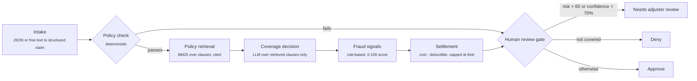

# ClaimPilot

**An agentic co-pilot that adjudicates auto insurance claims in seconds: policy checks, cited coverage reasoning, fraud scoring and settlement, with a human in the loop where it matters.**


> Screenshot placeholder: run the app and capture `/claims/CLM-2410` to `docs/screenshot.png`.

## The problem

First notice of loss is still mostly manual. An adjuster reads a narrative, looks up the policy, checks the premium and coverage period, hunts through policy wording for the clause that applies, sanity-checks the repair estimate, and does the deductible math. That is slow and inconsistent, and the reasoning is rarely written down.

ClaimPilot automates the routine path end to end and makes every step auditable. Straightforward claims are decided in seconds. Risky or ambiguous ones are routed to an adjuster with the evidence already assembled.

## How it works

A LangGraph state machine runs seven nodes. Each node emits a `step_start` and `step_end` event that the UI streams live over SSE, so the reasoning trace is visible as it happens.



| Step | What it does | LLM? |
| --- | --- | --- |
| Intake | Parses a JSON payload or a free-text narrative (email, call transcript) into structured fields | Live mode only, for free text |
| Policy check | Policy exists, premium is paid, date of loss is inside the coverage period | No |
| Policy retrieval | Multi-query BM25 over clause-level chunks of the policy wording: a coverage query plus an exclusions probe. Returns exact clauses with relevance scores | No |
| Coverage decision | Decides coverage using **only** the retrieved clauses and cites clause ids. Exclusions override insuring agreements | Yes (canned in demo mode) |
| Fraud signals | Early claim after inception, cost far above a repair benchmark, repeat claims, vague narrative, late report, missing police report. Weighted into a 0-100 score with reasons | No |
| Settlement | `payout = min(max(approved cost - deductible, 0), limit)` | No |
| Human review gate | Routes to an adjuster when risk > 60 or confidence < 70% | No |

Every decision returns the decision (Approve / Deny / Review), payout, confidence, cited clauses, fraud flags and the full step-by-step trace.

## Features

- **Live agent timeline.** Each node streams in with a spinner, then a check and its duration. Expand any step to see its reasoning.
- **Cited coverage reasoning.** Every decision links to the exact clauses of the policy wording (Form PA-2026) it relied on.
- **Explainable fraud score.** A risk gauge plus each signal's weight and evidence, never a black-box number.
- **Human-in-the-loop.** A review gate routes risky claims, with Approve and Send to adjuster actions and an activity log.
- **Claims inbox.** Status pills, risk bars, search and filters, plus `Cmd+K` search across every claim.
- **New claim intake.** A structured form or a free-text narrative, with three "Load sample" buttons: clean approve, deny for exclusion, and fraud flagged.
- **Analytics.** Straight-through rate, approved payouts, average risk, decisions by day and top fraud signals.
- **Demo mode by default.** Seeded claims and canned LLM responses, so it runs with no API keys.

## Tech stack

- **Backend:** Python 3.11+, FastAPI, Pydantic v2, LangGraph, Anthropic SDK (live mode), pytest, uv
- **Frontend:** Next.js 16 (App Router), React 19, Tailwind CSS v4, shadcn/ui, Motion (Framer Motion), Recharts, cmdk, Geist

## Quick start (demo mode, no keys)

Prerequisites: [uv](https://docs.astral.sh/uv/) and Node 20+ with pnpm.

```bash
# 1. API on :8000
cd backend
uv sync
uv run uvicorn app.main:app --port 8000
```

```bash
# 2. Web app on :3000 (new terminal)
cd frontend
pnpm install
pnpm dev
```

Open http://localhost:3000. Two seeded claims are **Pending**: open one to watch the agent run live. Or go to **New claim**, then **Load sample**, then **Submit and run agent**.

Run the tests:

```bash
cd backend && uv run pytest
```

### Live mode (optional)

Copy `backend/.env.example` to `backend/.env`, set `DEMO_MODE=false` and add `ANTHROPIC_API_KEY`. Intake (free text) and the coverage decision then call Claude (`claude-opus-5-5` by default, configurable with `CLAIMPILOT_MODEL`) with structured outputs. If the call fails, the node falls back to the deterministic reasoner and says so in the trace. `.env` is gitignored.

| Variable | Default | Purpose |
| --- | --- | --- |
| `DEMO_MODE` | `true` | Canned LLM responses, no network |
| `DEMO_STEP_DELAY_MS` | `650` | Per-step pacing while streaming in demo mode |
| `ANTHROPIC_API_KEY` | — | Required for live mode |
| `CLAIMPILOT_MODEL` | `claude-opus-5-5` | Model for live mode |
| `CORS_ORIGINS` | `http://localhost:3000` | Allowed web origins |
| `NEXT_PUBLIC_API_URL` | `http://localhost:8000` | API base URL for the frontend |

## API

| Method | Path | Description |
| --- | --- | --- |
| `POST` | `/claims/evaluate` | Run the agent on `{claim_id}` or a new `{claim}`. Streams `claim`, `step_start`, `step_end`, `result` and `error` events over SSE |
| `GET` | `/claims` | List claims, newest first |
| `POST` | `/claims` | Create a claim (structured fields or `text`) without running it |
| `GET` | `/claims/{id}` | Claim with policy, result, trace and audit log |
| `POST` | `/claims/{id}/action` | Adjuster action: `approve`, `deny` or `escalate` |
| `GET` | `/stats` | Aggregates for the analytics page |

## Project structure

```
backend/
  app/
    agent/
      graph.py          LangGraph pipeline, traced nodes, review gate
      intake.py         JSON / free-text parsing into a Claim
      policy_check.py   deterministic policy validation
      retrieval.py      clause chunking + BM25 multi-query retrieval
      coverage.py       LLM coverage reasoner + canned demo reasoner
      fraud.py          rule-based risk scoring
      settlement.py     payout math
      llm.py            Claude client for live mode
    data/               policies, policy wording (Form PA-2026), seed claims
    main.py             FastAPI app and SSE endpoint
    store.py            in-memory claim store and analytics
  tests/                policy check, fraud, settlement and API tests
frontend/
  src/app/              inbox, claim detail, new claim, analytics
  src/components/       app shell, Cmd+K palette, timeline, decision card, gauges
  src/lib/              typed API client and SSE stream parser
```

## Design notes

- **Deterministic where it should be.** Eligibility, fraud rules and money math never touch the LLM, so they are testable and reproducible. The LLM only interprets policy language, and only the clauses retrieval returned.
- **Every number has a reason.** Fraud weights, settlement lines and cited clauses are shown in the UI next to the decision.
- **Swap points.** `PolicyIndex.search` can be replaced by an embedding store, and `store.py` by a database, without touching the graph.

## Acknowledgements

Inspired by [zarreh/auto_insurance_claim_agent](https://github.com/zarreh/auto_insurance_claim_agent) (MIT).
